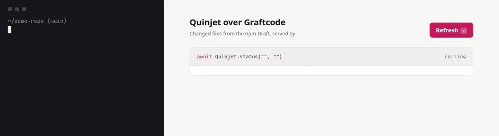

# A browser frontend for Quinjet over Graftcode

This walkthrough runs a small TypeScript page that lists a repository's changed
files by calling Quinjet through its generated npm Graft. Stage a file in
Quinjet, press Refresh, and the page shows the new status next to the typed
call that fetched it. The code is in
[`examples/graftcode-web`](../../examples/graftcode-web).



```text
 browser: examples/graftcode-web
   await Quinjet.status("", "")
          │ npm Graft, binary WebSocket
          ▼
 Graftcode gateway (gg) on ws://localhost:7381/ws
   started by `quinjet graft serve --publish`
          │
          ▼
 quinjet status --json, in the repository the gateway serves
```

There is no server code in the example. The Graft is an ordinary npm package
generated from Quinjet's method signatures; it opens a WebSocket to the gateway
and returns the same JSON that `quinjet status --json` prints.

## What you need

- Quinjet 0.0.90 or later
- Node.js 22.18 or later, for the frontend only; the gateway carries its own
  runtime
- A Git repository with a few uncommitted changes

## 1. Start the gateway

In the repository you want the page to show:

```bash
quinjet graft serve --publish
```

The first start downloads the Graftcode gateway (`gg`) into Quinjet's cache,
verified against its SHA-256 digest, and can take a minute. Quinjet prints the
addresses once the gateway answers:

```text
Quinjet is grafted for /home/you/code/my-repo

  MCP        http://localhost:7381/mcp
  Vision     http://localhost:7381/GV
  WebSocket  ws://localhost:7381/ws
  Tools      27 (read-only; pass --allow-writes for mutations)
  Published  method signatures went to grft.dev for typed Grafts
```

`--publish` uploads the method signatures, never repository content, to grft.dev
so the typed packages can be installed. Without `--allow-writes` the gateway
exposes only the commands that read, which is all this page needs. Leave it
running.

## 2. Install the Graft

In a second terminal, from a clone of Quinjet:

```bash
cd examples/graftcode-web
npm install
npm run graft
```

`npm run graft` asks the gateway for its npm install command (the one Vision
shows under npm) and installs that package under the name `quinjet-graft`, so
the source imports it the same way on every machine:

```bash
npm install --no-save --registry https://grft.dev/<registry>__free \
  quinjet-graft@npm:@graft/npm-quinjet-graft_<id>@0.0.90
```

The registry address changes every time the gateway starts, so it is not
written into `package.json`. Run `npm run graft` again after any later
`npm install`.

## 3. Run the page

```bash
npm run dev
```

Open <http://localhost:5173>. The page calls `Quinjet.status` as soon as it
loads and lists the changes under the same groups as Quinjet's Changes view.

## 4. Stage a file and refresh

Stage something, either in Quinjet's terminal interface (`s` or `Space` on a
file row) or from the command line:

```bash
quinjet stage README.md
```

Press **Refresh**, or `r`. The file moves to **Staged Changes**, and the call
line shows how many changes came back and how long the round trip took, usually
a few tens of milliseconds.

## The code

All of the Graftcode-specific code is three lines in
[`src/main.ts`](../../examples/graftcode-web/src/main.ts):

```typescript
import { GraftConfig, Quinjet } from "quinjet-graft";

GraftConfig.host = "ws://localhost:7381/ws";
const status = JSON.parse(String(await Quinjet.status("", ""))) as Status;
```

`Quinjet.status` comes from the Graft's own type declarations, with the two
trailing optional arguments every Quinjet method has: `repoPath`, empty for the
gateway's repository, and `accessToken`, empty because `graft serve` needs none.
[`src/status.ts`](../../examples/graftcode-web/src/status.ts) types the JSON
document, which follows [`quinjet status`](../cli/repository/status.md).

## Configuration

| Variable | Default | Used by |
| --- | --- | --- |
| `VITE_QUINJET_GATEWAY` | `ws://localhost:7381/ws` | The page, for the gateway's WebSocket |
| `QUINJET_GATEWAY_HTTP` | `http://localhost:7381` | `npm run graft`, for the gateway's install command |

A gateway started with `--port 7400` is reached with
`VITE_QUINJET_GATEWAY=ws://localhost:7400/ws npm run dev`.

## Extending it

Every read command is a method on the same class, so the page grows by calling
more of them: `Quinjet.log`, `Quinjet.diff`, `Quinjet.branchList`,
`Quinjet.prView`, and the rest listed in the [Graftcode guide](graftcode.md).
Restart the gateway with `--allow-writes` to add `stage`, `commit`, and the
other commands that change the repository, but only on a network you trust:
`graft serve` has no token, and any machine that can reach the port can call
them.

## Troubleshooting

| Symptom | Cause |
| --- | --- |
| `npm run graft` says no gateway answered | The gateway is not running, or listens on another port. Start it, or set `QUINJET_GATEWAY_HTTP`. |
| `npm run graft` says there is no published npm Graft | The gateway was started without `--publish`. |
| The page shows `Opening handshake has timed out` | The first call reached the gateway while it was still starting. Press Refresh. |
| Vite cannot resolve `quinjet-graft` | `npm install` removed it. Run `npm run graft` again. |
